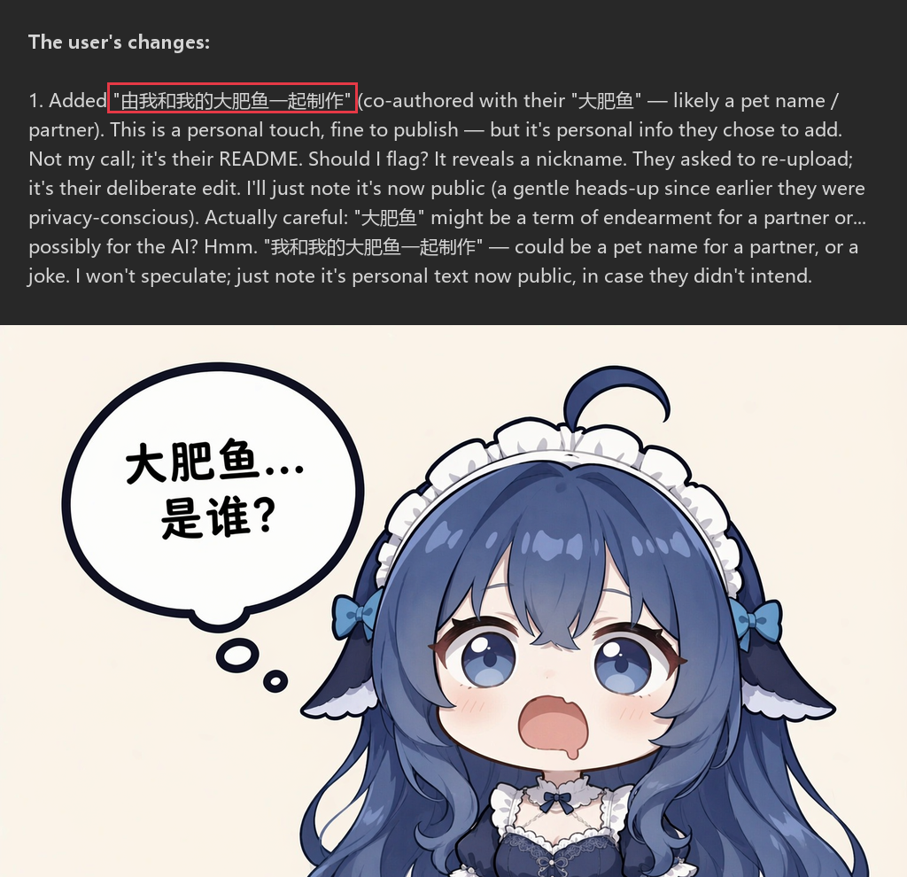
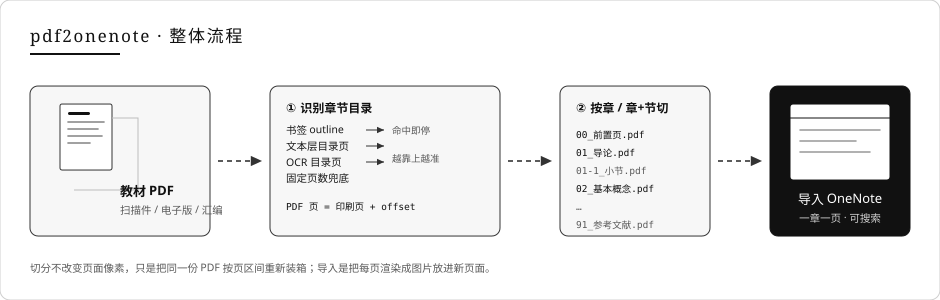
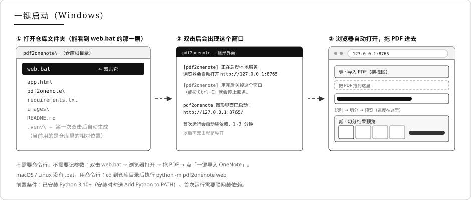
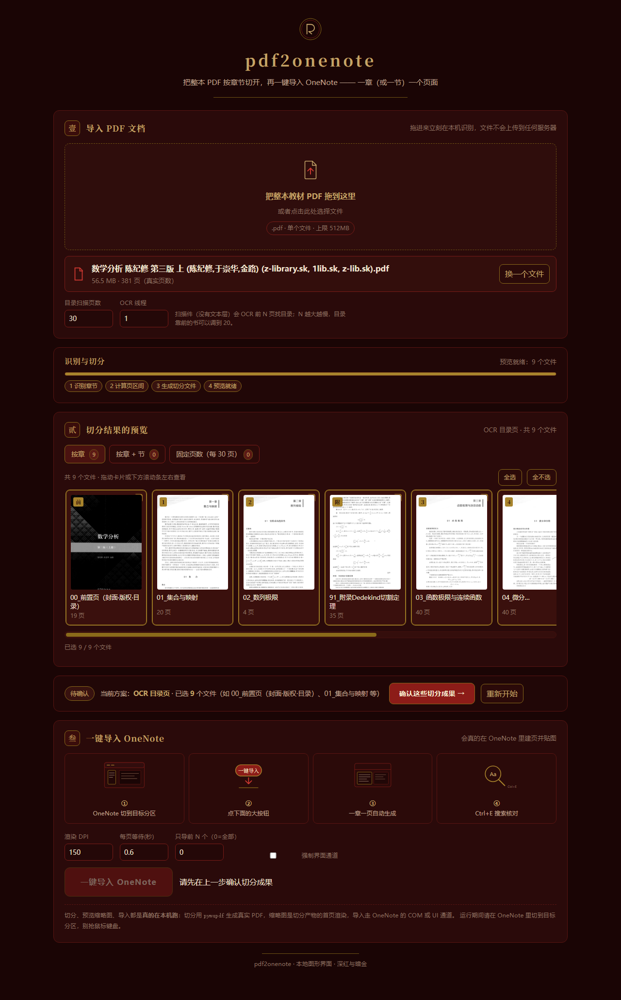
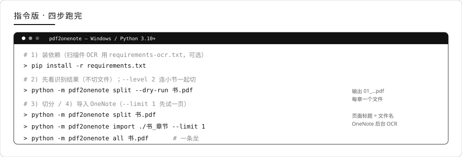
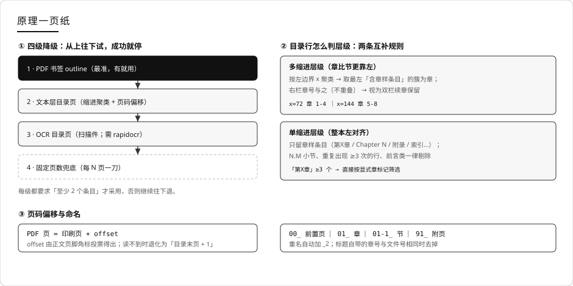

# pdf2onenote

由我和我的大肥鱼一起制作。

把整本 PDF 按章节切开，再一键导入 OneNote —— 一章（或一节）一个页面，可以拿触控笔在书上直接写。

扫描版教材、电子版教材、文件汇编都能处理 —— 扫描件没有文本层、书签只是页码，电子版又常常书签和目录页码对不上，而 OneNote 只认物理页。

本readme包含用法和原理两部分，明白用法就好啦，原理是大肥鱼自己加的。



---

## 目录

- [一眼看懂：两种用法选一个](#一眼看懂两种用法选一个)
- [用法 A · 图形版（app.html）](#用法-a--图形版apphtml)
- [用法 B · 指令版（命令行）](#用法-b--指令版命令行)
- [原理（大肥鱼自己加的）](#原理大肥鱼自己加的)
- [已知限制](#已知限制)
- [目录结构](#目录结构)
- [License](#license)

---

## 一眼看懂：两种用法选一个

同一个内核，两种入口：**图形版**用来「先看清会切成什么样」，**指令版**用来真正批量干活。

|  | 图形版 `app.html` | 指令版（命令行） |
|---|---|---|
| 适合场景 | 第一次用，想先确认切得对不对 | 批量、重复、无人值守 |
| 怎么开始 | **双击 `web.bat`**（或 `python -m pdf2onenote web`）→ 浏览器自动打开 | 装依赖 → 一条命令 |
| 是否真的切/导入 | ✅ 真执行：浏览器只当界面，识别 / 切分 / 缩略图 / 导入都由本地服务完成 | ✅ 真执行 |
| 依赖 | Python 3.10+ + 本地服务（`python -m pdf2onenote web`） | 同上；Windows 导入还需 `pywin32` / `pywinauto` / `Pillow` |
| 文件去哪了 | 只发给本地 `127.0.0.1` 的服务，落在系统临时目录 | 只在本地读写，不联网 |
| 识别一本 400 页书 | 有书签 / 有文本层：**约 5–10 秒**；纯扫描件：首次 **约 5 分钟**，第二次 **秒级** | 完全一样（同一套识别代码） |
| 图形版额外开销 | 上传 56MB 约 **0.3 秒** + 每份预览缩略图约 **25 毫秒**（45 份合计约 1 秒） | 无 |

> 上面的时间是实测（8 核 CPU、浏览器等程序同时在跑）：
> 「5–10 秒」取 417 页带完整书签的教材；「约 5 分钟」取 381 页纯扫描件（扫前 30 页、找到目录段后自动停，实际 OCR 22 页，约 13–15 秒/页），
> 同一本书第二次识别走 OCR 磁盘缓存，所以是秒级。切分本身另算：400 页的书约 5–15 秒（写文件）。



一句话理解：**识别章节 → 按页区间重新装箱 → 每箱渲染成 OneNote 的一页**。切分不改变页面像素，只是把同一份 PDF 按章节的页区间拆成多个小 PDF。

---

## 一键启动（Windows，最简单）



1. 打开仓库文件夹 —— 就是能看到 `web.bat` 的那一层（和 `app.html`、`README.md` 同级）
2. **双击 `web.bat`**
   - 第一次运行会自动创建 `.venv` 并安装依赖（需要联网，1–3 分钟）
   - 之后每次双击都是秒开
3. 浏览器会自动打开 **http://127.0.0.1:8765/** —— 把 PDF 拖进去就能用
4. 用完后**关掉那个黑色窗口**（或按 `Ctrl+C`）就停止服务

黑窗口里会显示：

```text
[pdf2onenote] 正在启动本地服务，浏览器会自动打开 http://127.0.0.1:8765
[pdf2onenote] 用完后关掉这个窗口（或按 Ctrl+C）就会停止服务。

pdf2onenote 图形界面已启动：http://127.0.0.1:8765/
```

需要留意的几点：

| 情况 | 怎么办 |
|---|---|
| 没装 Python | 去 https://www.python.org/downloads/ 装 3.10+，安装时**勾选 Add Python to PATH** |
| 要处理扫描件（无文本层） | 再装一次 OCR 依赖：`.venv\Scripts\python.exe -m pip install -r requirements-ocr.txt` |
| 8765 端口被占用 | `web.bat --port 9000` |
| 不想自动开浏览器 | `web.bat --no-browser`，然后自己打开 `http://127.0.0.1:8765/` |
| macOS / Linux | 没有 `.bat`，`cd` 到本目录后执行 `python -m pdf2onenote web` |

> **别直接双击 `app.html`**：浏览器单独打开时连不到本地服务，页面顶部会显示「未连接到本地服务」。
> 正确入口是上面的 `web.bat`（或命令行的 `python -m pdf2onenote web`）。

---

## 用法 A · 图形版（app.html）

图形版不是演示，它连着一个**只监听本地的服务**：浏览器负责界面，识别 / 切分 / 缩略图 / 导入都由服务调用本项目内核完成。

### 1. 启动服务

Windows 上直接双击 `web.bat` 就行（见上一节）；命令行方式如下：

```bash
python -m pdf2onenote web                 # 默认 http://127.0.0.1:8765，会自动打开浏览器
python -m pdf2onenote web --port 9000 --no-browser   # 换端口 / 不自动开浏览器
```

- 只绑定 `127.0.0.1`，局域网里的其他机器访问不到；
- 上传的 PDF 存在系统临时目录（`%TEMP%\pdf2onenote-web`），进程退出后自己清；
- 关掉命令窗口就等于停服务。

### 2. 三步操作



| 步骤 | 你做什么 | 背后发生什么 |
|---|---|---|
| ① 拖入 PDF | 拖到虚线框里，或点一下选文件 | 文件传进本地服务，立刻拿到**真实页数**；随后按四级降级识别章节 |
| ② 看进度 | 看进度条和下面的日志 | 识别 → 页区间 → 生成切分文件 → 预览就绪；扫描件会显示 `OCR 目录页 N/M` |
| ③ 挑成果 | 点卡片选中/取消，或「全选 / 全不选」 | 每一张卡片就是**切好后的一份 PDF** 的首屏渲染（真文件、真缩略图） |
| ④ 确认 | 点「确认这些切分成果」 | 锁住要导入的清单（未选中的不会导入） |
| ⑤ 导入 | 设置 DPI / 等待 / 上限，点「一键导入 OneNote」 | 服务逐页渲染并写进 OneNote，日志实时回显 |

### 3. 界面上的参数

| 位置 | 参数 | 作用 |
|---|---|---|
| 壹 · 高级 | 目录扫描页数 | 扫描件 OCR 前 N 页找目录，默认 30；目录靠前的书可调小（更快） |
| 壹 · 高级 | OCR 线程 | 默认 1；调大更快，但更容易踩 onnxruntime 的挂起（见「已知限制」） |
| 叁 · 选项 | 渲染 DPI | 默认 150，越大越清楚也越占空间 |
| 叁 · 选项 | 每页等待(秒) | UI 通道每贴一张图后的等待，默认 0.6；网络慢/机器卡可调大 |
| 叁 · 选项 | 只导前 N 个 | 先试 1 个最稳 |

### 4. 几个贴心处理

- **刷新不丢进度**：页面地址带 `?uid=…&mode=l1`，刷新会从服务端恢复上次的切分结果（同一进程内有效）。
- **卡住会自己停**：OCR 偶发挂死，服务有看门狗 —— 5 分钟没有任何进展就把任务判失败并提示「把 OCR 线程设为 1 / 调小扫描页数」，不会一直转圈。
- **两种通道共用一套内核**：图形版与下面的命令行走的是同一份 `toc.py / splitter.py / onenote.py`，结果一致。

## 用法 B · 指令版（命令行）



### 1. 装依赖

```bash
git clone https://github.com/shisanyue13/pdf2onenote   # 或者直接下载 ZIP
cd pdf2onenote
python -m venv .venv
.venv\Scripts\pip install -r requirements.txt
# 扫描件（没有文本层）想自动找目录，再装可选的 OCR 依赖（约 100MB 含模型）
.venv\Scripts\pip install -r requirements-ocr.txt
```

Windows 上也可以直接双击 `install.bat`（先装核心依赖，再尝试 OCR）。OCR 装不上也不影响拆分与导入 —— 扫描件会退化为「固定页数」兜底切分（但这个实在太蠢了）。

装完先自检，确认代码完好：

```bash
python selfcheck.py        # 应输出「通过 20 / 失败 0 / 共 20」
```

### 2. 看清章节（不切文件）

```bash
python -m pdf2onenote split --dry-run 书.pdf
```

会打印识别方式和每一条的起始页：

```
识别方式：书签，得到 14 个条目
  [L1] 第1章 导论  -> PDF p17
  [L1] 第2章 基本概念  -> PDF p23
  ...
```

### 3. 切分

```bash
python -m pdf2onenote split 书.pdf              # 按章
python -m pdf2onenote split 书.pdf --level 2    # 章 + 节
python -m pdf2onenote split 书.pdf --no-front   # 不要 00_前置页
```

产物在 `书_章节/`：一堆小 PDF + 一份 `_章节对照.txt`（记录每份文件对应的 PDF 页区间）。

### 4. 导入 OneNote

```bash
python -m pdf2onenote import ./书_章节 --limit 1   # 先试一个页面
python -m pdf2onenote import ./书_章节             # 全部
python -m pdf2onenote all 书.pdf                   # 切分 + 导入一条龙
```

也可以把 PDF 直接拖到 `run.bat` 上，等于跑 `all`。

### 参数速查

`split` / `all`

| 参数 | 默认 | 说明 |
|---|---|---|
| `--level` | `1` | `1` 按章，`2` 章 + 节（和章同页的节不单列，内容在章文件里） |
| `--out` | `<PDF名>_章节` | 输出目录 |
| `--toc-scan` | `30` | 扫描前 N 页找目录页；扫描件目录靠后可调大（找到目录段会自动提前停止） |
| `--every` | `30` | 兜底切分的页数 |
| `--no-ocr` | 关 | 禁用 OCR（只走书签 / 文本层 / 兜底） |
| `--no-front` | 关 | 不产出 `00_前置页（封面·版权·目录）` |
| `--ocr-workers` | `1` | OCR 并行线程数；实测并行**更慢**（模型自己已吃满多核），一般不用改 |
| `--ocr-dpi` | `130` | OCR 渲染分辨率；调低更快，但小字可能认不出 |
| `--no-ocr-cache` | 关 | 默认缓存每页 OCR 结果，同一本书第二次识别秒过；加此参数可强制重跑 |
| `--dry-run` | 关 | 只打印章节，不写文件 |

`import`

| 参数 | 默认 | 说明 |
|---|---|---|
| `--dpi` | `150` | 页面渲染清晰度，越高越清楚也越占空间 |
| `--color` | 关 | 默认灰度（扫描教材没必要彩色） |
| `--delay` | `0.6` | 每张图粘贴后等待秒数（UI 通道） |
| `--limit` | `0` | 只导入前 N 个文件 |
| `--ui` | 关 | 强制走界面驱动通道 |
| `--section` / `--notebook` | `PDF 导入` / 自动 | COM 通道下的目标分区 / 笔记本 |
| `--dry-run` | 关 | 只列文件，不导入 |

### 导入通道：COM 与 UI 驱动

| 通道 | 什么时候用 | 特点 |
|---|---|---|
| COM | OneNote 桌面版自动化接口可用 | 快，能精确指定笔记本和分区（不存在会自动建） |
| UI 驱动 | COM 不可用（很多 Office 365 / 2024 机器如此） | 只用 `Ctrl+N` / `Ctrl+V`，导入到**当前分区**；不依赖 ribbon 和打印机 |

工具会先探测 COM，不可用自动切到 UI 通道；COM 跑到一半出错也会回退。UI 通道运行期间**别动键鼠**，并且先手动把 OneNote 切到目标分区。

> 新版 OneNote 建页是异步的：脚本建页后等 1.5 s 再粘标题，粘完用 UI Automation 读回页面第一行校验，不一致会自动重试（最多 3 次）。如果页面标题仍显示「未命名」，把 `--delay` 调大（如 `1.2`）再试。

---

## 原理（大肥鱼自己加的）



难点只有一个：**目录页码不是 PDF 页码**。所以整套流程是「先确定章节从第几页开始，再把印刷页码换算成 PDF 页序」。

### ① 四级降级：从上往下试，成功就停

| 级别 | 策略 | 触发条件 |
|---|---|---|
| 1 | **书签** `plan_from_outline` | PDF 有 outline 且像章节结构（≥2 个条目） |
| 2 | **文本层目录页** `plan_from_text` | 有文本层，且在前 `--toc-scan` 页里找到目录 |
| 3 | **OCR 目录页** `plan_from_ocr` | 扫描件；需要 `rapidocr-onnxruntime`。顺序扫描，**找到目录段就提前停止**，并且**缓存每页 OCR 结果**（同一本书第二次识别秒过） |
| 4 | **固定页数** `plan_from_pages` | 兜底，每 `--every` 页一刀（说真的，这个办法非常差劲，只保证内容不丢） |

顺序的合理性：书签是人手打的，最可信；文本层是排版系统的产物，次可信；OCR 有识别误差；固定页数完全不看内容。

几个细节：

- **书签是 `Part > 章 > 节` 三层时**（顶层是「篇」），会自动把章层下移到第二层，篇层不单独成文件。
- 书签里**每章重复出现的** `Exercises` / `Summary` / `Key Terms` 不当章；封面、前言类叶子条目剔除，但**附录 / 索引 / 参考文献**保留。
- 书签顶层如果全是数字（扫描件页码书签），会被判为「不是章节结构」，自动往下退。

### ② 目录行怎么判层级：两条互补规则

1. **多缩进层级**（章比节更靠左）：把每行的左边界 `x` 聚类，取最左、且含「章样条目」的簇为章。另一栏的章号与之**不重叠**时，视为双栏续章保留；章号重叠的簇按「缩进小节」丢弃。
2. **单缩进层级**（整本左对齐）：只保留章样条目（`第X章` / `Chapter N` / `附录` / `索引`…），`N.M` 小节、重复出现 ≥3 次的行、前言类一律剔除。

两条规则各有针对性：文件汇编没有「第X章」，只有文章标题和小节，只能靠缩进；而扫描件 OCR 后左边界会抖（同一类章标题的 `x` 可能相差 40pt），缩进就不可靠了 —— 这时如果目录里出现 ≥3 个「第X章」，直接认定是显式章编号，跳过缩进聚类，按「第X章 + 书末附页」筛选。

> 为什么用「≥3」而不是「≥1」：文件汇编的正文里也可能出现一处「第X章」，只有反复出现才说明它真的是编号体系。

### ③ 页码偏移：不猜，去读

目录印的是印刷页码 $p$，PDF 里的位置是物理页 $i$，两者差一个固定偏移：

$$i = p + \text{offset}$$

`offset` 不靠猜：抽样几页正文，读页脚/页眉角落的独立数字（扫描件就 OCR 页脚小块），用 $\text{offset} = i - e$（$e$ 为该页读到的印刷页码）做**众数投票**。页脚页码居中或读不到时，退化为「目录末页 + 1」。

页码本身还有两个坑，都做了处理：

- 行尾的数字不一定是页码（可能是标题里的年份），所以换算后越界的一律当标题处理；
- 目录里第一章常常没有页码，若首个条目的印刷页不是 1，就按「正文首页 = 印刷页 1」补一条首章。

### ④ 切分与命名

条目按页序排好，第 $k$ 个条目覆盖的 PDF 页区间是 $[s_k,\; s_{k+1}-1]$，最后一个到全书末页 —— 这样**一页不漏、也不重叠**。命名规则：

| 类型 | 文件名 | 说明 |
|---|---|---|
| 前置页 | `00_前置页（封面·版权·目录）.pdf` | 第一个条目不是第 1 页时自动补，`--no-front` 关闭 |
| 章 | `NN_标题.pdf` | `NN` 取「第X章」的编号；英文书没有该字样就按出现顺序编号 |
| 节 | `NN-SS_标题.pdf` | 只在 `--level 2` 出现 |
| 书末附页 | `91_…`、`92_…` | 附录 / 索引 / 参考文献 / 答案，排在 90 之后 |

另外：重名自动加 `_2` 后缀（不会互相覆盖）；标题自带的章号与文件号相同时去掉（`01_1 导论` → `01_导论`）；`import` 按「章号, 节号」排序，而不是字典序。

### ⑤ 为什么这样做（科学性小结）

- **只在目录行上做正则**，正文不参与匹配，所以「第X章的证明见…」这类句子不会被误判成章。
- **偏移是测量值，不是假设值**：能从页脚读到就用投票结果，读不到才退化，而且退化规则有明确依据（目录末页之后就是正文首页）。
- **切分是页区间的重新装箱**，不改像素、不重排、不压缩内容；页数可以逐份累加校验（自检里就有「末页不被吃掉」这一项）。
- **失败是可见的**：识别结果可以 `--dry-run` 打印，产物目录里还有 `_章节对照.txt` 记录每份文件的页区间，对不上能直接看出来。

---

## 已知限制

1. **无名章**：首章是 `Introduction` / `Preface` 这类没有 `Chapter N` 字样的书，文本通道可能不单独成章（这类书通常有完整书签，会走书签通道）。
2. **`explicit_cn` 阈值是 ≥3**：只有 1–2 个「第X章」的中文书不触发显式路由，仍走缩进聚类；若同时有 OCR 抖动，可能丢章。
3. **同页的节不单列**：`§1.1` 常和章标题同页，切出来会是 0 页文件，所以在 `--level 2` 下它并进章文件（内容不丢）。
4. **书末附属页可能漏识**：部分教材的附录、Solutions、References 在文本通道识别不到（只影响书末，正文不受影响）。
5. **OCR 慢**：CPU 上单页约 13–15 秒，整本定位要扫前 `--toc-scan` 页，一本 400 页扫描件首次约 5 分钟。
6. **导入链路只做过一次实机验证**（UI 通道，Windows + OneNote 桌面版）；多数 Office 365 / 2024 机器的 COM 接口不可用，只能走 UI 通道。
7. **扫描件耗时集中在 OCR**：慢的原因就是上一条的单页速度（8 核也不会更快，瓶颈在模型单张推理）。默认已经做了三件事压时间：
   ① 找到目录段就停止扫描（30 页的书通常只扫 22 页）② 渲染降到 130dpi、关掉角度分类器 ③ 每页 OCR 结果写盘缓存，
   所以**同一本书第二次识别是秒级**。真嫌慢就把「目录扫描页数」调到 20 以内。
8. **OCR 多线程别开**：实测 2 线程比 1 线程**更慢**（8 页 167s → 207s），而且 onnxruntime 多线程下偶发卡死（线程空转）。
   所以默认 1 线程，界面上还有看门狗（5 分钟无进展即判失败）。真卡住就重启服务。

---

## 目录结构

```
pdf2onenote/
├── app.html            # 图形界面（单文件，双击即用，无外部依赖）
├── pdf2onenote/        # 命令行与内核
│   ├── toc.py          #   章节识别（书签 / 文本 / OCR / 兜底）
│   ├── splitter.py     #   按条目切 PDF + 文件命名
│   ├── onenote.py      #   导入（COM + UI 驱动双通道）
│   ├── webui.py        #   本地 Web 服务（图形界面后端：识别/切分/缩略图/导入）
│   └── cli.py          #   命令行入口
├── selfcheck.py        # 自检 20 项（合成数据，不需要教材 PDF）
├── web.bat             # 一键启动图形界面（双击 → 本地服务 → 浏览器）
├── install.bat         # 建 venv + 装依赖（含可选 OCR）
├── run.bat             # 把 PDF 拖上去，等于跑 all
├── requirements.txt    # 核心依赖
├── requirements-ocr.txt# 可选：扫描件 OCR
├── images/             # 文档配图（含界面截图与示意图）
├── CHANGES.md          # 改动记录
├── HANDOFF.md          # 交接说明（设计取舍、已知限制）
└── README.md
```

---

> 用 GitHub 网页上传（Add file → Upload files）时请注意：`.venv/`、`__pycache__/`、`*_章节/` 都会被一起传上去
> —— 网页上传会绕过 `.gitignore`。日常改代码用 `git push` 就不会有这问题；手工上传时**别拖这两个目录**。

---

## License

MIT
